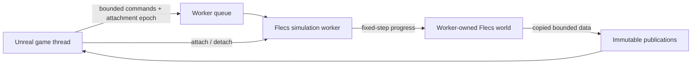
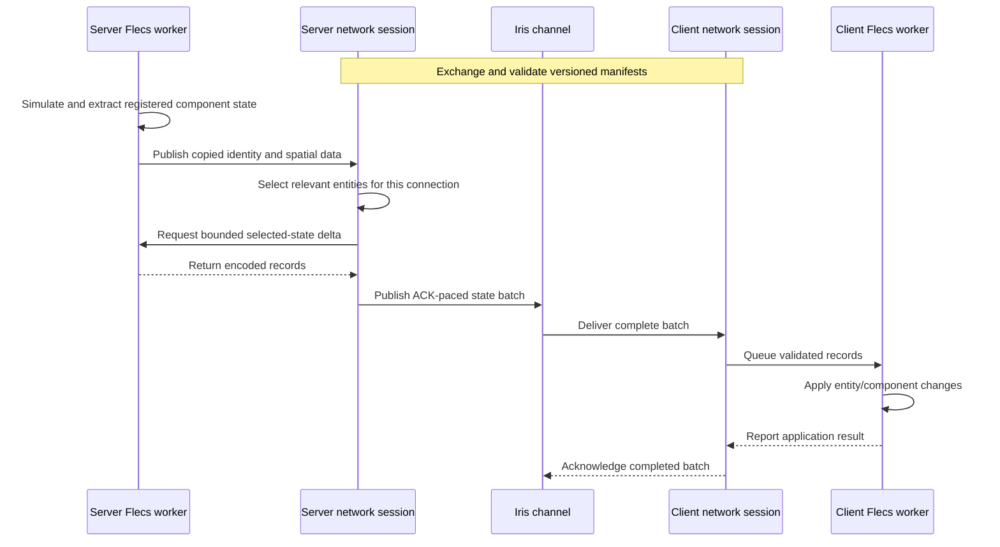

<div align="center">


# Flecs Unreal

### Worker-owned entity simulation and Iris replication for Unreal Engine

[](https://www.unrealengine.com/)
[](https://github.com/SanderMertens/flecs)
[](https://isocpp.org/)
[](#requirements)
[](#modules)
[](#how-replication-works)
[](#simulation-and-thread-ownership)
[](#supported-modes-and-current-limits)
[](#diagnostics)
[](LICENSE)

[Overview](#what-is-included) · [Get started](#get-started) · [Replication](#how-replication-works) · [Diagnostics](#diagnostics) · [Modules](#modules)

</div>

---

Flecs Unreal integrates the [Flecs entity component system](https://github.com/SanderMertens/flecs) into Unreal Engine. A dedicated worker owns each active simulation world; the networking module can publish selected, authoritative component state to clients through Unreal's Iris replication system.

The plugin provides the infrastructure. Your game defines its own components, worker systems, network schemas, codecs, and gameplay rules.

## What is included

- **Worker-owned simulation:** an Unreal game instance attaches a Flecs world to its active Unreal world. The worker creates, advances, and destroys that Flecs world.
- **Fixed-step execution:** configurable simulation rate, 60 Hz by default, with bounded command admission, explicit pause/resume, and world-attachment epochs.
- **System registration:** register world-scoped `OnUpdate` systems or persistent worker commands, data publishers, and paired lifecycle callbacks.
- **Copied publications:** extract bounded data on the worker and consume immutable snapshots on the game thread without sharing live Flecs references.
- **Iris networking:** owner-only replication channels, bounded payload serialization, manifest handshake, state batches, acknowledgements, and a server-tick heartbeat.
- **Server authority and relevance:** server-assigned network identities, per-connection selection, distance tiers, ownership/visibility rules, budgets, component lifecycle, and despawn.
- **Native schema registry:** trusted component, entity, and command definitions with versioned manifests and peer-specific wire mappings.
- **Quantization primitives:** reusable fixed-step signed values, 16-bit circular angles, and explicit network-order integer encoding.
- **Diagnostics:** Unreal stat groups, an optional viewport overlay, and opt-in Flecs system-time and world-memory sampling.
- **Automation source:** uncooked plugin tests for simulation, network, registry, codecs, relevance, and diagnostics.

## Requirements

| Requirement | Current integration |
| --- | --- |
| Unreal Engine | The host project targets **UE 5.7**. Verify compatibility with your own engine version. |
| Language | An Unreal C++ project or C++ game module. |
| Platform | The bundled static library is configured for **Win64**. Other platforms need their own Flecs library and build configuration. |
| Flecs | Bundled headers identify **4.1.6**. Keep headers, static library, and build options compatible. |
| Iris | Enable Unreal's **Iris** plugin and configure Iris replication in the host project. The example project enables `net.Iris.UseIrisReplication=1`. |
| Network gameplay | Your game must register matching schemas and trusted worker-safe callbacks on the server and clients. |

> The library exports a curated set of Flecs symbols through the `FLECS` module. It is not a blanket export of every upstream API. See [FLECSThirdParty](Source/FLECSThirdParty/README.md) for linking details.

## Get started

### 1. Install and enable the plugin

Place this repository at `YourProject/Plugins/FLECS`, enable **FLECS** and **Iris** for the project, and regenerate project files as appropriate for your Unreal setup. The plugin descriptor declares its Iris dependency.

The host example enables Iris in `Config/DefaultEngine.ini`:

```ini
[SystemSettings]
net.Iris.UseIrisReplication=1
net.SubObjects.DefaultUseSubObjectReplicationList=1
```

Apply the Iris configuration appropriate to your engine version and project. Add the modules your game uses to its `.Build.cs`:

```csharp
PrivateDependencyModuleNames.AddRange(new string[]
{
    "FLECS",         // Worker and world integration
    "FLECSNetwork",  // Iris session and network entity model
    "FLECSModding"   // Native schema and manifest registry
});
```

Use `PublicDependencyModuleNames` instead for dependencies exposed by your module's public headers. A game using only the worker API can depend on `FLECS` without using network APIs.

### 2. Register a worker system

Register from the game thread once the world is ready. This system operates on **local** Flecs components; registration alone does not enable replication.

```cpp
#include "Engine/World.h"
#include "Subsystems/FlecsSubsystem.h"

struct FHealth
{
    float Value = 100.0f;
};

bool RegisterHealthSystem(UWorld& World)
{
    UFlecsSubsystem* Flecs = World.GetSubsystem<UFlecsSubsystem>();
    return Flecs && Flecs->RegisterOnUpdateSystem<FHealth>(
        TEXT("Game.Health"),
        [](FHealth& Health)
        {
            Health.Value = FMath::Max(0.0f, Health.Value);
        });
}
```

The return value means registration was **queued**, not that it has already executed. Call `UnregisterSystem` when appropriate. For one-off work, obtain `UFlecsGameInstanceSubsystem`, read its current `GetActiveEpoch()` on the game thread, and call `SubmitWorkerCommand`. Handle rejection, stale epochs, and shutdown.

To create a local entity, submit a command that calls `WorkerWorld.entity()` and sets its components on the worker. Use the network model's authoritative spawn path for entities that should replicate. See the [FLECS module guide](Source/FLECS/README.md) for publications and lifecycle APIs.

### 3. Configure network schemas

Install a default session configurator **before world creation**, commonly in your game module's startup. This is a skeleton: `RegisterMyGameSchemas` represents your own registration function and must be implemented by your game.

```cpp
#include "Networking/FlecsGenericNetworkSessionSubsystem.h"

// Implement this in your game. Register schemas and trusted hooks through Registrar.
bool RegisterMyGameSchemas(UWorld& World,
    FFlecsNetworkSessionRegistrar& Registrar, FString& OutError);

// During game module startup:
const bool bInstalled = UFlecsNetworkSessionSubsystem::SetDefaultConfigurator(
    [](UWorld& World, FFlecsNetworkSessionRegistrar& Registrar, FString& Error)
    {
        return RegisterMyGameSchemas(World, Registrar, Error);
    },
    1); // Protocol version

// During game module shutdown:
UFlecsNetworkSessionSubsystem::ClearDefaultConfigurator();
```

Check `bInstalled` and report registration errors in your game. The default configurator is process-wide, but is called with a world: create separate worker-owned state for each session. Register schemas, definitions, and trusted hooks **before registry freeze**. The [network module guide](Source/FLECSNetwork/README.md) describes session events and spawn APIs; the [registry guide](Source/FLECSModding/README.md) describes the schema contract.

### 4. Add the component data you need

A replicated component schema supplies a stable ID, version, maximum encoded size, visibility/rate metadata, and worker-safe `Extract`, `Apply`, and `Remove` callbacks. Entity definitions specify which schemas may be present and how to create an entity. For spatial relevance, register a position accessor or an explicit policy for entities without positions.

Use explicit, bounded serialization. Replicate health by registering it in the entity definition; leave stamina local by not registering or including it in a replicated payload. Quantization is **opt-in per codec**: the plugin supplies helpers, but it does not automatically quantize every component.

## Simulation and thread ownership



- Each active attached world session has its own dedicated `FlecsSimulation` worker and Flecs world. Network connections do not each create a server simulation worker.
- Commands are applied at step boundaries before world progress. The queue and per-step processing are bounded. `SetSimulationPaused` controls the worker explicitly.
- The worker's fixed rate is configured under **Project Settings → Plugins → FLECS → Simulation** and is independent of render FPS. Changing it takes effect on world attachment.
- Worker callbacks must not capture or access UObjects, actors, or Unreal connection state. Do not retain Flecs worlds, entities, iterators, or pointers across worker calls or world detachments.
- Use copied publications for game-thread presentation. A local attachment epoch is not the same thing as a server network epoch.

## How replication works



1. **Register and negotiate.** Server and client register compatible versioned manifests. A peer must complete the handshake before it can use the network session. Compact wire IDs are peer mappings, not local Flecs entity IDs.
2. **Simulate on the server.** The worker model owns authoritative network identities and component lifecycle. Registered schemas encode state; the model can detect encoded changes made by worker systems.
3. **Select per connection.** Spatial metadata, visibility, distance tiers, component rates, and budgets determine which records are eligible. The default view position is the player controller's focal location; a trusted provider can customize interest.
4. **Transfer through Iris.** An owner-only channel sends bounded state records through an Iris fast array. A complete client batch is queued to the client worker and acknowledged after application. The server tick heartbeat is separate from state batches.
5. **Handle relevance and lifetime.** Leaving relevance removes that client's local replica while the server entity can continue to exist. An authoritative despawn is a separate operation; a relevant entity can later be created again on a client.

Use `QueueSharedEntitySpawn` for an unowned authoritative entity and `QueuePeerEntitySpawn` for a peer-owned entity. Their return values report queue admission; `SharedSpawnFinished` and `PeerSpawnFinished` report worker completion. Client commands are subject to authoritative permission and validation checks.

## Scaling networked worlds

Configure capacity under **Project Settings → Plugins → FLECS → Networking → Limits**. These limits are captured when the network session starts.

| Setting | Default | Purpose |
| --- | ---: | --- |
| `MaxNetworkEntities` | 5,000 | Maximum network-managed entities in the world; configurable up to 100,000. |
| `MaxPeerOwnedEntities` | 256 | Maximum entities owned by one peer, bounded by the world capacity. |
| `MaxRelevantEntitiesPerPeer` | 5,000 | Maximum relevant entities retained for one peer, bounded by the world capacity. |
| `MaxRecordsPerPeerSelection` | 128 | Default entity-record budget for one peer selection; configurable up to 16,384. |
| `MaxPayloadKiBPerPeerSelection` | 64 KiB | Default byte budget for one peer selection; configurable up to 4,096 KiB. |

Server and client must use the same world entity capacity; the versioned session handshake rejects mismatches. A spawn over the world or ownership limit reports `LimitReached`. When a peer's relevance capacity or selection budget is full, additional eligible work is deferred. An entity leaving relevance keeps its slot until its exit is acknowledged. Local Flecs entities do not count against the network-managed world limit.

The worker captures spatial metadata and live identities and transfers them to the game thread in bounded, acknowledged chunks. Relevance selection uses a complete generation; the server tick heartbeat can advance while a snapshot is in flight. The world limit is a capacity bound, not a performance guarantee: memory use, snapshot latency, and achievable update rates depend on your game. See [FLECSNetwork](Source/FLECSNetwork/README.md#capacity-and-per-peer-budgets) for retained-state limits and failure behavior.

## Settings and diagnostics

**Project Settings → Plugins → FLECS** contains the simulation frequency and distance/update-rate tiers. Distances are in Unreal centimeters; rates are in Hz. Tier rates are replication limits, not simulation rates. Component caps, visibility, hysteresis, custom interest, budgets, and network conditions can further affect delivery.

| Console command | Purpose |
| --- | --- |
| `stat Flecs` | Worker step, Flecs progress, queue/publication counters, and memory stats. |
| `stat FlecsNetwork` | Relevance and transfer cycles, payload counters, and tracked channel and partial spatial-container allocations. |
| `flecs.Diagnostics.Overlay 1` | Show the local per-world plugin viewport overlay. |
| `flecs.Diagnostics.WorldMemory 1` | Enable at-most-once-per-second Flecs world-memory sampling. |
| `flecs.Diagnostics.SystemTime 1` | Enable Flecs system-time measurements. |

Payload totals and rates represent logical Flecs payload bytes, **not wire bandwidth**: they exclude Iris framing, packet overhead, and retransmission. Flecs world memory and tracked plugin buffers are not total process memory. Both optional samplers have overhead. Dedicated servers use stat groups without a viewport.

## Modules

| Module | Purpose |
| --- | --- |
| [FLECS](Source/FLECS/README.md) | Worker, world attachment, systems, publications, settings, and simulation stats. |
| [FLECSNetwork](Source/FLECSNetwork/README.md) | Iris channels, session lifecycle, authoritative entity model, relevance, codecs, and network diagnostics. |
| [FLECSModding](Source/FLECSModding/README.md) | Trusted native schemas, entity definitions, commands, manifests, and mappings. |
| [FLECSUncooked](Source/FLECSUncooked/README.md) | Uncooked Unreal automation source for plugin modules. |
| [FLECSThirdParty](Source/FLECSThirdParty/README.md) | External build module for the bundled Win64 Flecs static library. |

## Supported modes and current limits

- The implementation supports local standalone authority and networked dedicated/listen-server authority, with client replicas. Validate the configurations your game ships.
- Data is replicated only when your game registers and includes it in a supported network schema. Arbitrary Flecs components, arbitrary UObject state, actor transforms, and client-only entities are not automatically replicated.
- The registry invokes **trusted native code**; it is not an untrusted mod sandbox or a general script loader.
- The current Iris channel uses bounded payloads. Registry limits and transport limits are different; a schema accepted by the registry can still exceed the transport's supported payload size.
- Interpolation and prediction are game presentation/gameplay concerns. The host example includes debug interpolation; the plugin does not automatically provide prediction, reconciliation, or actor visualization.
- The plugin contains automation source, but support badges do not imply that a particular build, platform, or live network session has passed.

## Upstream and license

Flecs was created by [Sander Mertens](https://github.com/SanderMertens). Visit the [original Flecs repository](https://github.com/SanderMertens/flecs) for upstream documentation and licensing. This Unreal integration is maintained by [Artem Podorozhko / Wellsaik](https://github.com/ArtemIyX).

This plugin is distributed under the [MIT License](LICENSE).
